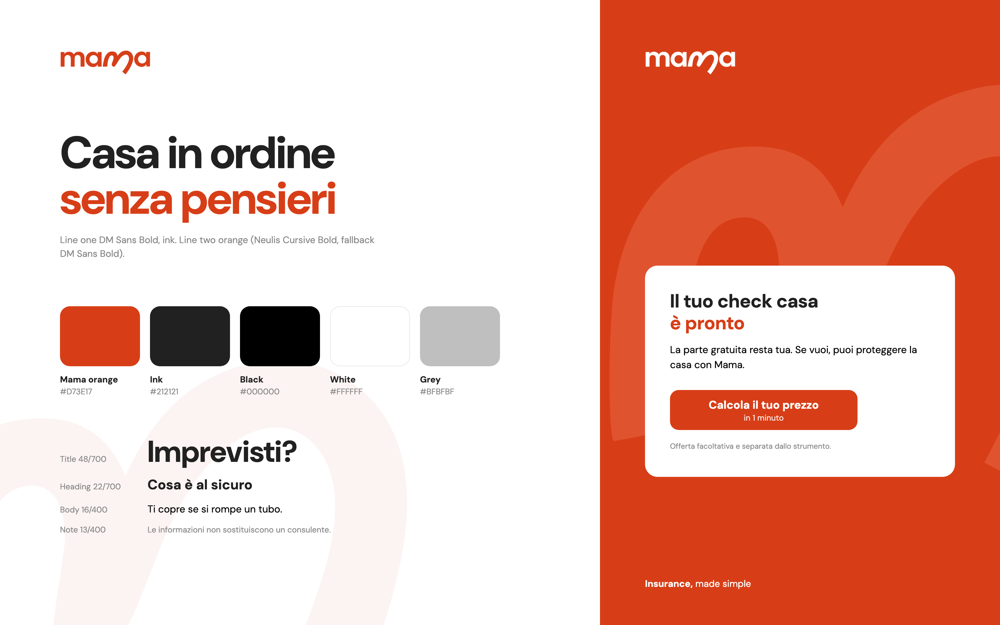

# DESIGN: Mama look and feel

Single source for every visual deliverable: the tool, the memo, the deck, the dashboard.
Sources: `assets/Brand kit/Mama brand kit for the squad.docx`, the company deck, and mamainsurance.it/it
(measured 2026-11-24).



## Colours

| Token | Hex | Use |
|---|---|---|
| `--orange` | `#D73E17` | Main buttons, the key word, the m, full orange sections |
| `--ink` | `#212121` | Titles, descriptions |
| `--black` | `#000000` | Body text, payoff, links |
| `--white` | `#FFFFFF` | Backgrounds, text on orange |
| `--grey` | `#BFBFBF` | Small secondary details |
| `--m-light` | `#FF957C` @ 24% | Only the m on orange |
| `--bar` / `--note` | `#E6E6E6` / `#8A8A8A` | Charts only: bars (the one that matters in orange), notes |

- Orange highlights **one thing at a time**. If everything is orange, nothing is.
- The site also uses a cream surface `#FCF7F1` for small cards and accent blues/greens in single sections.
  We stick to the brand kit palette; cream is allowed for small cards only.

## Type

- **DM Sans** for everything (Google Fonts): 400 text, 500 lead, 700 titles and numbers.
- **Neulis Cursive Bold** only for short highlights (2nd title line, label). Not on Google Fonts:
  fallback is DM Sans Bold in the same colour. Never for body or numbers.
- **Title pattern:** two lines. Line one DM Sans Bold, ink. Line two orange, cursive. E.g. "Casa in ordine / senza pensieri".
- Scale seen on site (desktop → mobile): H1 54 → 32, H2 48 → 28, H3 22, lead 26/500 grey `#434343`, body 16/24.
  Tight title leading (1.0 to 1.1), slight negative tracking.

## Layout and components

- Mobile first (Exhibit 5). Text aligned left. Generous white space, 16 px side gutter on phone.
- Section blocks: radius 20 px, no borders. Small cards: radius 15 px, soft shadow `0 4px 10px rgba(0,0,0,.15)`.
- **Quote CTA** (copy the site): orange fill, white text, radius 12 to 15 px, height 48 to 64 px, two lines:
  **"Calcola il tuo prezzo"** (bold) + "in 1 minuto" (small). One per screen.
- Secondary buttons: white with orange or ink text. No icons as filler.
- **The m** (`assets/Brand kit/Mama m.svg`) is the only graphic: big, bleeding off the edge. Full orange on white,
  5% opacity behind content, `#FF957C` 24% on orange. No boxes, lines, shadows or decorative icons to fill space.
- **Logo:** `Mama logo orange.png` on light, `Mama logo white.png` on orange. Proportional resize only, free space around.
- Payoff when needed: "**Insurance,** made simple". Address: mamainsurance.it.

## Tone of voice (Italian for anything users see)

| Do | Don't |
|---|---|
| "Ti copre se si rompe un tubo" | "Garanzia danni da acqua condotta" |
| Short sentences, one idea each | Long clauses, jargon |
| Light irony ("TV fritta", "Ci pensa Mama") | Jokes about people's misfortune |
| Say what's free, what isn't, what's not covered | Hidden conditions |
| Offer insurance as optional, separate | Pushy upsell, fake urgency |
| Commas, colons, full stops | Dashes |

## Quote link

```
https://www.mamainsurance.it/?utm_source=mama_tools&utm_medium=<tool_name>&utm_campaign=albert_bdd
```
Same tags everywhere. Log every click as a funnel event.

## Exhibit 5: definition of done for the tool

- [ ] Works on a phone, first-time user, no explanations
- [ ] Core task < 3 min, no purchase, no mandatory sign-up
- [ ] One clear Mama quote button, tracked by source
- [ ] Marketing consent asked separately from the task
- [ ] Disclaimer wherever it gives legal, fiscal or technical advice
- [ ] Each funnel step recorded in a simple dashboard
- [ ] Looks like Mama: tone, colours, plain language (this file)

## Files

- Board: `assets/design/mama-design-board.png` (philosophy: `assets/design/philosophy.md`)
- Logos, m: `assets/Brand kit/`
